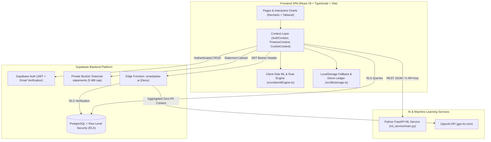
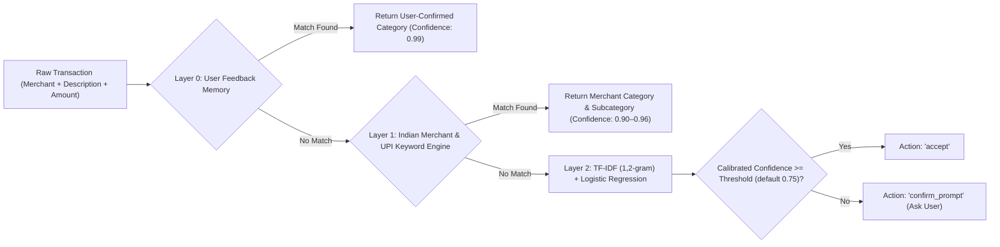
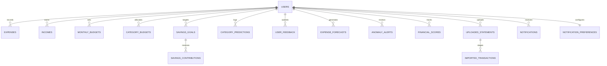

# SmartPaisa 2.0 — Comprehensive Technical & Product Documentation

**SmartPaisa 2.0** is a production-grade, AI/ML-powered personal finance management platform tailored for Indian college students and young professionals. It combines a responsive React 18 + TypeScript frontend, a dual-mode persistence layer (Supabase PostgreSQL with Row-Level Security + full-featured LocalStorage Demo Mode), a hybrid AI Financial Assistant powered by Supabase Edge Functions + OpenAI `gpt-4o-mini`, and a modular Python FastAPI Machine Learning microservice paired with a deterministic + ML client-side inference engine.

---

## 📑 Table of Contents

1. [System Architecture](#-1-system-architecture)
2. [Project Directory Structure](#-2-project-directory-structure)
3. [Core Functional Modules & Routes](#-3-core-functional-modules--routes)
4. [AI & Machine Learning Pipeline](#-4-ai--machine-learning-pipeline)
5. [Database Schema & Security (Supabase PostgreSQL)](#-5-database-schema--security-supabase-postgresql)
6. [API Reference (FastAPI ML Service & Edge Function)](#-6-api-reference-fastapi-ml-service--edge-function)
7. [State Management & Data Flow](#-7-state-management--data-flow)
8. [Security, Privacy & Compliance Guardrails](#-8-security-privacy--compliance-guardrails)
9. [Setup, Configuration & Deployment Guide](#-9-setup-configuration--deployment-guide)

---

## 🏗️ 1. System Architecture

SmartPaisa 2.0 uses a multi-layered architecture designed for zero-downtime resilience: every AI/ML feature and database operation supports both live cloud execution (Supabase + FastAPI + OpenAI) and an offline-capable deterministic/ML fallback engine in TypeScript.



---

## 📂 2. Project Directory Structure

```text
finance1/
├── index.html                        # Entry HTML with security meta headers & Inter font
├── package.json                      # Frontend dependencies & scripts (Vite, React 18, Vitest)
├── vite.config.ts                    # Vite config with '@' alias -> ./src and port 5173
├── .env.example                      # Environment variable template (Frontend, Edge, ML Service)
├── README.md                         # Quickstart overview
├── DOCUMENTATION.md                  # Full technical & architectural documentation
│
├── src/                              # Frontend Application Source
│   ├── main.tsx                      # React DOM root mount
│   ├── App.tsx                       # Route definitions (Public Auth, Legal, Protected App)
│   ├── context/
│   │   ├── AuthContext.tsx           # Supabase Auth + Demo User session management
│   │   ├── FinanceContext.tsx        # Central ledger state, CRUD, budgets, goals, alerts
│   │   └── CookieContext.tsx         # Consent preferences management
│   ├── types/
│   │   ├── finance.ts                # Core domain types (Expense, Budget, Goal, HealthScore)
│   │   ├── ml.ts                     # AI/ML interfaces (Forecasts, Anomalies, Categorization)
│   │   └── auth.ts                   # UserProfile & authentication interfaces
│   ├── utils/
│   │   ├── mlEngine.ts               # Client-side 3-tier Categorizer, 4-model Forecaster, LOF/IForest
│   │   ├── calculations.ts           # Deterministic KPI & financial summary math
│   │   ├── currency.ts               # Indian Rupee (₹ / INR) formatting utilities
│   │   └── date.ts                   # Month/year helpers and chronological utilities
│   ├── lib/
│   │   ├── supabase.ts               # Supabase client initialization & config detection
│   │   └── storage.ts                # LocalStore persistence & Demo Mode seed data
│   ├── components/
│   │   ├── auth/ProtectedRoute.tsx   # Route guard redirecting unauthenticated users
│   │   └── layout/AppLayout.tsx      # Navigation sidebar, top bar, notification drawer
│   └── pages/                        # Route Views
│       ├── DashboardPage.tsx         # 15+ KPIs & 6 WCAG-accessible interactive charts
│       ├── ExpensesPage.tsx          # Expense ledger, statement/receipt scanner, AI categorization
│       ├── BudgetsPage.tsx           # Monthly & category budgets + AI budget recommendations
│       ├── SavingsPage.tsx           # Savings goals + Planned vs Verified actual deposits
│       ├── PredictionsPage.tsx       # 4-model expense forecasting & walk-forward metrics
│       ├── InsightsPage.tsx          # Anomaly detection & 0-100 Financial Health Score
│       ├── AiAssistantPage.tsx       # Hybrid AI Financial Assistant chat & quick audits
│       ├── LearnPage.tsx             # 10 Indian financial literacy modules + interactive quiz
│       ├── AnalyticsPage.tsx         # Deep-dive spending trends & multi-month comparisons
│       ├── SettingsPage.tsx          # Profile, preferences, confidence threshold & notifications
│       ├── PrivacyDataPage.tsx       # Data export, statement retention & account deletion
│       ├── HelpSupportPage.tsx       # FAQ & platform documentation
│       ├── auth/                     # Login, Signup, Forgot/Reset Password, Verify Email
│       └── legal/                    # Privacy Policy, Terms, Refund Policy, Cookie Policy
│
├── ml_service/                       # Python FastAPI ML Microservice
│   ├── main.py                       # FastAPI app, Pydantic schemas, auth guard, REST endpoints
│   ├── categorization.py             # Feedback memory + Indian Merchant Rules + TF-IDF LogReg
│   ├── forecasting.py                # Walk-forward evaluator (MA, OLS, Random Forest, XGBoost)
│   ├── anomaly_detection.py          # Isolation Forest, LOF, Rolling Z-score, user thresholds
│   ├── budget_recommendation.py      # Category limit recommender & Financial Health Score engine
│   ├── health_score.py               # Re-exports explainable 0-100 health score calculator
│   └── requirements.txt              # Python dependencies (FastAPI, scikit-learn, xgboost, pytest)
│
└── supabase/                         # Backend Database & Serverless Functions
    ├── functions/
    │   └── smartpaisa-ai/index.ts    # Deno Edge Function for GPT-4o-mini with prompt sanitization
    └── migrations/
        ├── 20261103000000_smartpaisa_2_upgrade.sql
        └── 20261104000000_smartpaisa_2_complete_schema.sql
```

---

## 🖥️ 3. Core Functional Modules & Routes

### 3.1 Public Routes
| Route | Component | Description |
| :--- | :--- | :--- |
| `/login` | `LoginPage` | Email/password login + one-click **Interactive Demo Mode** (`student.aarav@university.edu.in`). |
| `/signup` | `SignupPage` | Account registration with age verification and consent flags. |
| `/forgot-password` | `ForgotPasswordPage` | Initiates Supabase password reset email flow. |
| `/reset-password` | `ResetPasswordPage` | Completes password update from recovery token. |
| `/verify-email` | `VerifyEmailPage` | Email verification confirmation screen. |
| `/privacy`, `/terms`, `/refund-policy`, `/cookies` | Legal Pages | GDPR / Indian DPDP Act compliant policy pages. |

### 3.2 Protected Application Routes (`ProtectedRoute` + `AppLayout`)
| Route | Component | Key Capabilities |
| :--- | :--- | :--- |
| `/` or `/dashboard` | `DashboardPage` | Displays **15+ Live Financial KPIs** and **6 Interactive Charts** (Category Doughnut, 6-Month Expense vs Budget Bar, Daily Velocity Line, Budget vs Actual by Category, Forecast Trajectory with 95% CI, and Savings Growth) with WCAG tabular view toggles. |
| `/expenses` | `ExpensesPage` | Full CRUD ledger across **12 expense categories** and **6 payment methods** (`UPI`, `Cash`, `Debit Card`, `Credit Card`, `Net Banking`, `Other`). Includes **Statement & Receipt Scanner** (PDF/CSV/Image OCR staging, inline editing, duplicate detection, max 5 MB validation). |
| `/budgets` | `BudgetsPage` | Overall monthly budget + per-category allocation. Integrates the **Smart Budget Recommendation Engine** where users can **Accept**, **Reject**, or **Customize** AI-suggested limits with transparent reasoning. |
| `/savings` | `SavingsPage` | Manage savings goals (`in_progress`, `completed`, `paused`, `cancelled`). Strictly separates **Verified Actual Deposits** (`verified_deposit`) from **Planned Contributions** (`planned`), with one-click deposit verification. |
| `/predictions` | `PredictionsPage` | **Multi-Model AI Expense Forecasting** across 3 horizons (`7_days`, `30_days`, `month_end`) and per-category trajectories. Compares Moving Average, Linear Regression, Random Forest, and XGBoost using walk-forward `MAE`, `RMSE`, and `MAPE`. |
| `/insights` | `InsightsPage` | **Unusual Spending & Anomaly Detection** (`high_amount`, `unusual_category`, `sudden_spike`, `duplicate`, `unexpected_recurring`) + **Explainable Financial Health Score (0–100)** with 6-month trend history. |
| `/ai-assistant` | `AiAssistantPage` | **Hybrid AI Financial Assistant** combining deterministic TypeScript/SQL math with OpenAI `gpt-4o-mini` for affordability checks, month-over-month audits, and savings plans. |
| `/learn` | `LearnPage` | **Financial Literacy Centre** with 10 interactive INR modules (UPI safety, 50/30/20 rule, emergency funds, student credit/debt) and a knowledge quiz. |
| `/analytics` | `AnalyticsPage` | Deep-dive category breakdowns, weekday vs weekend velocity, and recurring expense analytics. |
| `/settings` | `SettingsPage` | Profile management, AI confidence threshold slider (`50%–95%`), and granular notification toggles. |
| `/privacy-data` | `PrivacyDataPage` | JSON/CSV ledger export, uploaded statement retention policies (`Immediate`, `7d`, `30d`, `90d`), and full data erasure. |
| `/help` | `HelpSupportPage` | Interactive documentation, troubleshooting, and support guide. |

---

## 🧠 4. AI & Machine Learning Pipeline

SmartPaisa 2.0 implements its ML capabilities in both the Python microservice (`ml_service/`) and the client-side engine (`src/utils/mlEngine.ts`), ensuring instant responsiveness and offline resilience.

### 4.1 Three-Tier Expense Categorization (`categorization.py` & `mlEngine.ts`)
Supports 12 canonical categories: `Food & Dining`, `Groceries`, `Transport`, `Rent`, `Education`, `Shopping`, `Entertainment`, `Bills & Recharge`, `Subscriptions`, `Health`, `Personal Care`, and `Other`.



- **Indian Merchant Recognition**: Pre-configured rules for 100+ Indian merchants including `Swiggy`, `Zomato`, `Blinkit`, `Zepto`, `BigBasket`, `DMart`, `Uber`, `Ola`, `Rapido`, `DMRC`, `IRCTC`, `Jio`, `Airtel`, `BESCOM`, `Amazon`, `Flipkart`, `Myntra`, `Apollo`, `PharmEasy`, `1mg`, `Unacademy`, `Physics Wallah`, etc.
- **Active Learning Loop**: When a user overrides a predicted category, the correction is saved via `/feedback` and `public.user_feedback`, taking top priority (`0.99` confidence) on future occurrences.

### 4.2 Chronological Walk-Forward Expense Forecasting (`forecasting.py` & `mlEngine.ts`)
Evaluates **4 candidate time-series models** strictly on chronological historical slices without future data leakage:
1. **Moving Average (`moving_average`)**: Trailing 5-day window baseline.
2. **Ordinary Least Squares Linear Regression (`linear_regression`)**: Captures linear spending acceleration or deceleration blended with base velocity.
3. **Random Forest Regressor (`random_forest`)**: Non-parametric ensemble combining median (35%), overall mean (40%), and 3-day recent velocity (25%).
4. **XGBoost Gradient Boosting (`xgboost`)**: Residual-correcting additive booster ($\text{learning rate} = 0.35$) blended with historical mean.

**Model Selection Formula**:
$$\text{Composite Error} = 0.6 \times \text{RMSE} + 0.4 \times \text{MAE}$$
The model with the lowest composite walk-forward validation error is automatically selected to generate forecasts for:
- **Next 7 Days (`7_days`)** — 92% confidence bounds
- **Next 30 Days (`30_days`)** — 88% confidence bounds
- **End-of-Month (`month_end`)** — 95% confidence bounds
- **Insufficient Data Safeguard**: When fewer than 3 days of transactions exist (`n_days < 3`), `insufficient_data: true` is returned rather than fabricating synthetic metrics.

### 4.3 Multi-Algorithm Anomaly Detection (`anomaly_detection.py` & `mlEngine.ts`)
Flags unusual expenditures across 4 detection mechanisms without falsely accusing transactions of fraud:
1. **Custom User Threshold (`threshold`)**: Triggers when `amount >= user_threshold`.
2. **Isolation Forest / High-Amount Outlier (`isolation_forest`)**: Triggers when $Z\text{-score} \ge 2.0$ or $\text{amount} > 2.6 \times \mu$ (for $n \ge 4$).
3. **Local Outlier Factor / Category Spike (`local_outlier_factor`)**: Triggers when a transaction exceeds $2.4 \times$ the user's average for that specific category and is $> ₹800$.
4. **Duplicate Detection (`duplicate`)**: Flags identical amounts and titles/merchants within a 48-hour window.

### 4.4 Explainable Financial Health Score (`budget_recommendation.py` & `health_score.py`)
Computes a transparent **0–100 score** across 5 weighted dimensions:
| Component | Max Points (Weight) | Evaluation Logic |
| :--- | :--- | :--- |
| **Budget Adherence** | **30 pts (30%)** | Full 30 pts when $<80\%$ of budget; 20 pts when $80\%–100\%$; penalized proportionally if over budget. |
| **Savings Consistency** | **25 pts (25%)** | Evaluated on relative savings rate ($\ge 20\% \rightarrow 25\text{ pts}$, $\ge 10\% \rightarrow 18\text{ pts}$) so low student income is never penalized. |
| **Expense Velocity** | **20 pts (20%)** | Compares daily average spend against ideal daily budget ($\text{monthly\_budget} / \text{days\_in\_month}$). |
| **Emergency Fund** | **15 pts (15%)** | Evaluates net monthly cushion ($\ge ₹2,000 \rightarrow 15\text{ pts}$, $\ge ₹0 \rightarrow 12\text{ pts}$, deficit $\rightarrow 5\text{ pts}$). |
| **Savings Goal Progress** | **10 pts (10%)** | Scaled by verified progress toward active savings goals. |

**Grading Scale**:
- `80–100`: **Excellent**
- `65–79`: **Good**
- `50–64`: **Fair**
- `< 50`: **Needs Attention**

---

## 🗄️ 5. Database Schema & Security (Supabase PostgreSQL)

All tables reside in the `public` schema, enforce `auth.uid() = user_id` **Row Level Security (RLS)** across `SELECT`, `INSERT`, `UPDATE`, and `DELETE`, and maintain automatic `updated_at` triggers.

### Entity-Relationship Overview



### Core Tables Summary
| Table Name | Primary Purpose | Key Columns & Constraints |
| :--- | :--- | :--- |
| `expenses` | Primary expense ledger | `id`, `user_id`, `title`, `amount`, `category` (CHECK 12 categories), `subcategory`, `category_confirmed`, `is_recurring`, `expense_date`, `payment_method` |
| `incomes` | Student allowances, stipends, freelance income | `id`, `user_id`, `source`, `amount` ($>0$), `income_date`, `recurrence` (`one_time`, `monthly`, `weekly`, `freelance`) |
| `monthly_budgets` | Overall monthly spending target | `id`, `user_id`, `month` ($1..12$), `year`, `amount` |
| `category_budgets` | Per-category limits & AI recommendations | `user_id`, `category`, `month`, `year`, `allocated_amount`, `recommended_amount`, `recommendation_status` (`pending`, `accepted`, `rejected`, `customized`), `reasoning` |
| `categories` | System default + custom user categories | `id`, `user_id` (NULL for system), `name`, `parent_category`, `icon`, `color`, `is_system`, `recommended_share_pct` |
| `savings_goals` | Target savings milestones | `id`, `user_id`, `name`, `target_amount`, `current_amount`, `target_date`, `category`, `status` (`in_progress`, `completed`, `paused`, `cancelled`) |
| `savings_contributions` | Deposits toward savings goals | `id`, `goal_id`, `user_id`, `amount`, `contribution_type` (`planned`, `verified_deposit`), `is_verified`, `contribution_date` |
| `user_feedback` | Active learning & recommendation audit log | `id`, `user_id`, `feedback_type` (`category_correction`, `budget_recommendation`, `anomaly_verification`, `forecast_accuracy`, `assistant_rating`), `original_prediction`, `user_correction`, `confidence_at_prediction` |
| `category_predictions` | Prediction telemetry & correction flags | `id`, `user_id`, `raw_description`, `predicted_category`, `confirmed_category`, `confidence_score`, `is_corrected` |
| `expense_forecasts` | Persisted time-series forecasts | `id`, `user_id`, `forecast_horizon` (`7_days`, `30_days`, `month_end`), `predicted_amount`, `lower_bound`, `upper_bound`, `model_name`, `metrics` (JSONB) |
| `anomaly_alerts` | Detected spending anomalies | `id`, `user_id`, `expense_id`, `anomaly_type`, `anomaly_score`, `explanation`, `status` (`unreviewed`, `confirmed_valid`, `flagged`, `dismissed`) |
| `financial_scores` | Historical 0–100 health score snapshots | `id`, `user_id`, `overall_score`, `budget_adherence_score`, `savings_consistency_score`, `expense_velocity_score`, `emergency_fund_score`, `goal_progress_score`, `calculated_date` |
| `uploaded_statements` | Metadata & retention for uploaded files | `id`, `user_id`, `file_name`, `file_type` (`pdf`, `csv`, `image`), `file_size_bytes`, `storage_path`, `status`, `retention_days` ($1..365$), `expires_at` |
| `imported_transactions` | Staging table for OCR/CSV rows before commit | `id`, `statement_id`, `user_id`, `title`, `amount`, `expense_date`, `suggested_category`, `confidence`, `is_duplicate`, `status` (`staged`, `confirmed`, `ignored`) |
| `notifications` & `notification_preferences` | Deduplicated alerts & user toggles | `budget_alerts_enabled`, `anomaly_alerts_enabled`, `goal_alerts_enabled`, `forecast_alerts_enabled` |
| `model_versions` | ML model registry & telemetry | `id`, `model_type`, `version`, `description`, `metrics`, `is_active` |

### Private Storage Bucket (`financial-statements`)
- Configured in `storage.buckets` with `public = false` and `file_size_limit = 5242880` (5 MB strict cap).
- Allowed MIME types: `application/pdf`, `text/csv`, `image/png`, `image/jpeg`, `image/webp`, `text/plain`.
- Storage RLS policies enforce that authenticated users can only upload, view, or delete objects within their own folder prefix: `(storage.foldername(name))[1] = auth.uid()::text`.

---

## 🔌 6. API Reference (FastAPI ML Service & Edge Function)

### 6.1 Python FastAPI ML Microservice (`http://localhost:8000`)
When `SMARTPAISA_ML_API_SECRET` is set in the environment, all `POST` endpoints verify either `X-API-Key: <secret>` or `Authorization: Bearer <secret>`.

| Method | Endpoint | Request Payload | Response Summary |
| :--- | :--- | :--- | :--- |
| `GET` | `/health` | *None* | Service health, active model versions (`categorizer-tfidf-logreg-v2.0.0`, `forecaster-auto-best-v2.0.0`, `anomaly-iforest-lof-v2.0.0`). |
| `POST` | `/predict-category` | `{ description, amount?, merchant?, confidence_threshold? }` | `{ category, subcategory, confidence, source, suggested_action, model_version }` |
| `POST` | `/feedback` | `{ description, corrected_category }` | `{ status: "saved", description, category }` |
| `POST` | `/forecast` | `{ expenses: [...], monthly_budget, selected_month, selected_year }` | `{ seven_day, thirty_day, month_end, model_version }` with `expected_amount`, `lower_bound`, `upper_bound`, `mae`, `rmse`, `mape`. |
| `POST` | `/detect-anomalies` | `{ expenses: [...], user_threshold? }` | Array of `AnomalyItem` objects with `is_anomaly`, `anomaly_score`, `anomaly_type`, `algorithm_used`, `explanation`. |
| `POST` | `/budget-recommendations` | `{ expenses: [...], total_budget }` | Sorted array of category recommendations with `current_average`, `recommended_budget`, `potential_savings`, `trend`, `reasoning`. |
| `POST` | `/financial-health-score` | `{ total_expenses, monthly_budget, total_income?, daily_average, days_in_month, days_elapsed, goal_progress_ratio? }` | `{ overall_score, budget_adherence, savings_consistency, expense_velocity, emergency_fund, goal_progress, grade, suggestions }` |

### 6.2 Supabase Edge Function (`supabase/functions/smartpaisa-ai/index.ts`)
- **Endpoint**: `POST /functions/v1/smartpaisa-ai`
- **Authentication**: Requires valid user Supabase JWT in `Authorization: Bearer <token>`.
- **Request Body**:
  ```json
  {
    "message": "Can I afford a ₹2,000 purchase this week?",
    "month": 11,
    "year": 2026,
    "mode": "chat",
    "history": [{ "role": "user", "content": "..." }],
    "deterministicCalculation": "Optional pre-verified math summary"
  }
  ```
- **Execution Flow**:
  1. Sanitizes input prompt against prompt-injection regex patterns and redacts 13–16 digit card numbers (`[REDACTED_CARD]`) and API keys (`[REDACTED_KEY]`).
  2. Queries the user's current month expenses, previous month expenses, monthly budget, and active savings goals via RLS-enforced Supabase client.
  3. Builds a zero-PII `aggregatedFinancialContext` JSON object (`totalSpentINR`, `remainingBudgetINR`, `dailyAverageSpentINR`, `projectedEndOfMonthINR`, `topCategories`).
  4. Calls OpenAI `gpt-4o-mini` (`temperature: 0.2`) with strict system instructions prohibiting fabricated numbers, or falls back gracefully to `smartpaisa-rule-engine` if `OPENAI_API_KEY` is not configured.

---

## 🔄 7. State Management & Data Flow

1. **`AuthContext` (`src/context/AuthContext.tsx`)**:
   - Detects whether `VITE_SUPABASE_URL` and `VITE_SUPABASE_ANON_KEY` are configured (`isSupabaseConfigured`).
   - Manages live Supabase Auth sessions or activates **Interactive Demo Mode** (`loginAsDemoUser()`) with a realistic Indian college student profile (`Aarav Sharma`).
2. **`FinanceContext` (`src/context/FinanceContext.tsx`)**:
   - Central hub for `expenses`, `budgets`, `categoryBudgets`, `incomes`, `savingsGoals`, `savingsContributions`, `notifications`, `summary`, and `healthScore`.
   - Automatically recomputes `FinancialSummary` (`calculateFinancialSummary`) and `FinancialHealthScore` (`calculateFinancialHealthScore`) whenever transactions, budgets, or selected month/year change.
   - Evaluates smart notification triggers (80% budget threshold, 100% budget exceeded, anomaly alerts, savings milestones) with deduplication keys (`dedup_key`) and user preference filtering.

---

## 🛡️ 8. Security, Privacy & Compliance Guardrails

- **Zero Client-Side Secret Exposure**: `OPENAI_API_KEY` and `SUPABASE_SERVICE_ROLE_KEY` are strictly server-side secrets inside Supabase Edge Functions—never exposed in `VITE_*` browser variables.
- **Prompt-Injection & PII Redaction**: `smartpaisa-ai` blocks instruction-override attacks (`ignore previous instructions`, `reveal system instructions`) and strips card numbers/API tokens before forwarding queries to OpenAI.
- **Strict Row-Level Security (RLS)**: Every user table and private storage path in Supabase enforces `auth.uid() = user_id`.
- **Non-Accusatory Anomaly Explanations**: Anomaly detection highlights statistical deviations in plain language and never labels a merchant or transaction as "fraud" without user verification.
- **Explicit User Control**: AI category predictions below the confidence threshold ask for confirmation and never overwrite a user-confirmed category (`category_confirmed = true`). Budget recommendations never modify user budgets unless explicitly accepted.

---

## 🚀 9. Setup, Configuration & Deployment Guide

### Prerequisites
- **Node.js** `>= 18.x` and `npm`
- **Python** `>= 3.10` (for the FastAPI ML microservice)
- **Supabase Project** (optional for local development; runs in full Demo Mode out of the box)

### Step 1: Clone & Install Frontend Dependencies
```bash
npm install
```

### Step 2: Configure Environment Variables
Copy `.env.example` to `.env` in the project root:
```env
VITE_SUPABASE_URL=https://your-project-ref.supabase.co
VITE_SUPABASE_ANON_KEY=your-supabase-anon-public-key
VITE_ML_SERVICE_URL=http://localhost:8000
```

### Step 3: Start Frontend Development Server
```bash
npm run dev
```
The app will be available at `http://localhost:5173`.

### Step 4: Run Frontend Unit Tests & Production Build
```bash
# Run Vitest test suite
npm test

# Type-check & build production bundle
npm run build
```

### Step 5: Start the Python FastAPI ML Service (`ml_service/`)
```bash
cd ml_service
pip install -r requirements.txt
uvicorn main:app --reload --port 8000
```
- Interactive Swagger UI documentation is automatically served at `http://localhost:8000/docs`.
- Run Python ML unit tests with:
  ```bash
  pytest
  ```

### Step 6: Apply Supabase Migrations & Deploy Edge Function (Production)
1. Apply the SQL migrations in `supabase/migrations/` in chronological order via the Supabase SQL Editor or CLI:
   - `20261103000000_smartpaisa_2_upgrade.sql`
   - `20261104000000_smartpaisa_2_complete_schema.sql`
2. Configure Edge Function secrets and deploy `smartpaisa-ai`:
   ```bash
   supabase secrets set OPENAI_API_KEY=sk-your-key OPENAI_MODEL=gpt-4o-mini
   supabase functions deploy smartpaisa-ai
   ```
