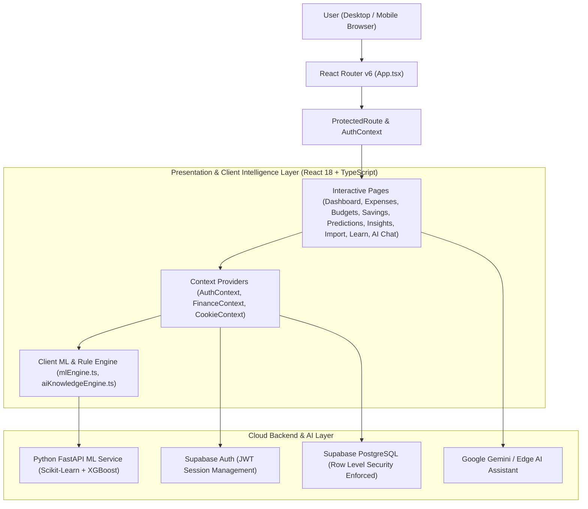
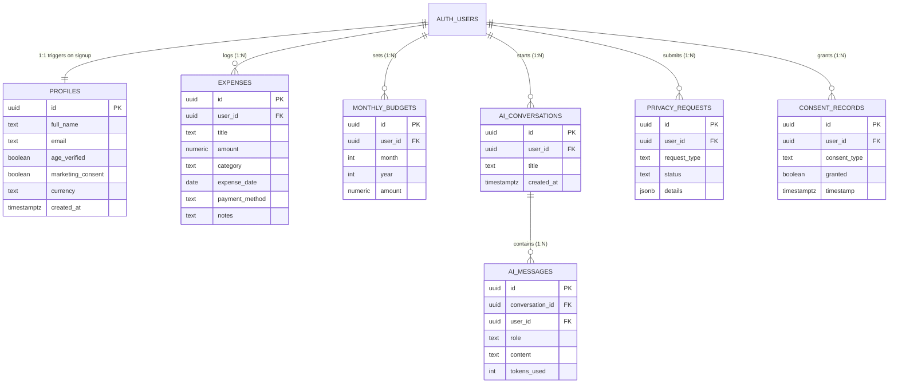

# SmartPaisa: AI-Powered Personal Finance & Budgeting Platform

---

## 1. Abstract
**SmartPaisa** is a full-stack, AI/ML-driven personal finance management platform designed specifically for **Indian college students and young professionals**. With the rapid adoption of instant digital payments (UPI, QR codes, and digital wallets), young earners and students make dozens of micro-transactions daily without visibility into their cumulative monthly burn rate. SmartPaisa solves this problem by combining automated Indian merchant & UPI transaction categorization, multi-model machine learning expenditure forecasting, statistical anomaly detection, explainable financial health scoring, goal-based savings tracking, and a conversational AI Financial Advisor—all secured with **Supabase PostgreSQL Row Level Security (RLS)** and **India's Digital Personal Data Protection (DPDP) Act 2023** compliance.

---

## 2. Problem Statement

### 2.1 Background & Core Problem
In India, over 75% of college students and early-career professionals rely on UPI (Google Pay, PhonePe, Paytm) for daily micro-transactions—ranging from ₹20 tea stalls and metro rides to food delivery (Swiggy/Zomato) and quick-commerce (Blinkit/Zepto). Because digital payments remove the psychological friction of handing over physical cash, users suffer from **"frictionless overspending"**:
1. **Unmonitored Micro-Transactions**: Small daily UPI payments accumulate into thousands of rupees by month-end without the user realizing where their allowance or salary went.
2. **Lack of Indian Context in Global Finance Apps**: Existing international budgeting tools fail to recognize Indian UPI descriptions, local merchants (IRCTC, DMRC, Jio, Apollo, Zepto), or irregular student allowance cycles.
3. **Reactive Instead of Predictive Tracking**: Traditional expense trackers only show *past* spending after a budget is already blown, offering no forward-looking prediction of end-of-month expenditure or daily safe-spending limits.
4. **Financial Illiteracy & Privacy Risks**: Many commercial finance apps monetize user data through predatory loan ads and lack transparent, explainable financial guidance tailored to students.

### 2.2 Limitations of Existing Systems vs. Proposed System (SmartPaisa)

| Parameter | Existing Traditional Expense Trackers | Proposed System (**SmartPaisa**) |
| :--- | :--- | :--- |
| **Transaction Entry & Categorization** | Manual category selection; fails on Indian UPI strings | **3-Tier AI Categorizer** recognizing 100+ Indian merchants + CSV/PDF/Receipt OCR import |
| **Budget Monitoring** | Static monthly cap; alerts only *after* overspending | **Dynamic Safe Daily Allowance** & proactive AI category recommendations |
| **Future Forecasting** | None (historical charts only) | **4-Model ML Time-Series Forecasting** (Moving Avg, OLS, Random Forest, XGBoost) with 95% Confidence Intervals |
| **Unusual Spend Detection** | None or simple fixed threshold | **Multi-Algorithm Anomaly Detection** (Isolation Forest, Local Outlier Factor, Z-Score, 48h Duplicate Check) |
| **Financial Health Assessment** | Arbitrary credit-based scores that penalize students without credit cards | **Explainable 0–100 Financial Health Score** based on relative savings & budget adherence |
| **Data Privacy & Security** | Often shares data with third-party loan marketers | **Bank-Grade Row Level Security (RLS)** + **DPDP Act 2023** data export & deletion controls |

---

## 3. Project Objectives
1. **Automate Indian Expense Categorization**: Accurately classify UPI and card transactions across 12 student-centric categories using a hybrid Rule + Machine Learning + Active Learning pipeline.
2. **Predict Future Expenditure**: Forecast 7-day, End-of-Month, and 30-day spending trajectories using ensemble time-series regression models with transparent accuracy metrics (`MAE`, `RMSE`, `MAPE`).
3. **Detect Spending Anomalies Early**: Identify unusual spending spikes, category drift, and duplicate charges before they derail a monthly budget.
4. **Provide Explainable Financial Guidance**: Deliver a conversational AI Financial Assistant and a 10-module Indian Financial Literacy Centre (`₹` denominated) to build long-term financial discipline.
5. **Enforce Strict Data Isolation**: Guarantee zero cross-account data leakage using PostgreSQL Row Level Security (`auth.uid() = user_id`).

---

## 4. System Architecture & Data Flow

### 4.1 High-Level System Architecture


### 4.2 Entity-Relationship (ER) Diagram


---

## 5. Core Functional Modules & Algorithms

### Module 1: Authentication & DPDP Compliance (`/login`, `/signup`, `/privacy-data`)
- **Features**: Email/Password sign-in, account registration, password recovery, 18+ age verification gate, and unbundled marketing consent.
- **Database Trigger**: Automatically provisions a `public.profiles` row via `public.handle_new_user()` immediately upon `auth.users` insertion.
- **Privacy Controls**: Users can export their entire financial ledger (`JSON`/`CSV`), customize cookie preferences, or request permanent account deletion.

### Module 2: Executive Financial Dashboard (`/dashboard`)
- **15+ Live Financial KPIs**:
  - Total Monthly Spend, Monthly Budget Cap, Remaining Balance
  - Safe Daily Allowance:
    $$\text{Safe Daily Spend} = \max\left(0, \frac{\text{Monthly Budget} - \text{Spent So Far}}{\text{Remaining Days in Month}}\right)$$
  - Daily Average Velocity, Savings Rate %, Budget Utilization %, Predicted End-of-Month Spend, and Financial Health Score.
- **6 Interactive Charts** (each equipped with a WCAG-accessible Tabular Data View toggle):
  1. Category-wise Expenditure Doughnut Chart
  2. 6-Month Budget vs. Actual Bar Comparison
  3. Daily Spending Velocity Line Chart
  4. Category Budget Utilization Bars
  5. Cumulative Spend vs. ML Forecast Trajectory (with 95% Confidence Interval band)
  6. Savings Goal Growth Trajectory

### Module 3: 3-Tier AI Expense Categorization (`/expenses`)
Classifies transactions across **12 categories** (`Food & Dining`, `Groceries`, `Transport`, `Rent`, `Education`, `Shopping`, `Entertainment`, `Bills & Recharge`, `Subscriptions`, `Health`, `Personal Care`, `Other`):
1. **Tier 1 — Active Learning User Feedback**: Stores user-corrected merchant mappings with `0.99` confidence so the system adapts immediately to personal habits.
2. **Tier 2 — Indian Merchant & UPI Keyword Rule Engine**: Deterministic dictionary matching 100+ Indian merchants (`Swiggy`, `Zomato`, `Blinkit`, `Zepto`, `BigBasket`, `Uber`, `Ola`, `Rapido`, `DMRC`, `IRCTC`, `Jio`, `Airtel`, `BESCOM`, `Apollo`, `Nykaa`, etc.).
3. **Tier 3 — TF-IDF + Logistic Regression Classifier**: Computes calibrated probability scores for unseen transaction strings. Prompts user confirmation when confidence falls below the user's configurable threshold (`50%–95%`).

### Module 4: Multi-Model Time-Series Expense Forecasting (`/predictions`)
Evaluates 4 chronological forecasting models using walk-forward validation (zero future-data leakage):
1. **Moving Average (Baseline)**: Rolling window mean of daily expenditure.
2. **Linear Regression (OLS)**: Captures linear spending drift over time.
3. **Random Forest Regressor**: Ensemble of decision trees capturing non-linear day-of-week and month-phase patterns.
4. **XGBoost Gradient Boosting**: Sequential boosted trees minimizing residual forecasting error.
- **Evaluation Metrics Computed Live**:
  $$\text{MAE} = \frac{1}{n}\sum_{i=1}^{n} |y_i - \hat{y}_i|, \quad \text{RMSE} = \sqrt{\frac{1}{n}\sum_{i=1}^{n}(y_i - \hat{y}_i)^2}, \quad \text{MAPE} = \frac{100\%}{n}\sum_{i=1}^{n}\left|\frac{y_i - \hat{y}_i}{y_i}\right|$$

### Module 5: Explainable Financial Health Score & Anomaly Detection (`/insights`)
- **Financial Health Score (0–100 Formula)**:
  $$\text{Score} = 0.30(\text{Budget Adherence}) + 0.25(\text{Savings Consistency}) + 0.20(\text{Expense Stability}) + 0.15(\text{Emergency Fund}) + 0.10(\text{Goal Progress})$$
  *Designed specifically so students with small allowances are evaluated on relative discipline rather than absolute income size.*
- **Anomaly Detection Pipeline**:
  - **Isolation Forest & Local Outlier Factor (LOF)**: Detects multi-dimensional outliers in transaction amount and frequency.
  - **Rolling Z-Score**: Flags transactions where $Z = \frac{x - \mu_{\text{category}}}{\sigma_{\text{category}}} > 2.5$.
  - **48-Hour Duplicate Detector**: Alerts users to accidental double UPI deductions of the same amount and merchant within 48 hours.

### Module 6: Smart Budgets & Savings Goals (`/budgets`, `/savings`)
- **AI Budget Recommendations**: Audits category-level historical averages and recommends realistic monthly caps with human-readable explanations (*Accept / Reject / Customize*).
- **Savings Goals**: Tracks target amounts and target dates while strictly separating **Verified Actual Deposits** from **Planned Contributions**.

### Module 7: Statement & Receipt Scanner (`/import`)
- Accepts **CSV Bank Statements**, **PDF Statements**, and **Receipt Images (OCR)** up to 5 MB.
- Parses rows into an interactive **Staging Table** with Zod schema validation, inline editing, AI category auto-assignment, and duplicate transaction flagging before final ledger commit.

### Module 8: Hybrid AI Financial Assistant & Literacy Hub (`/ai-assistant`, `/learn`)
- **AI Assistant**: Combines exact TypeScript/SQL ledger calculations with **Google Gemini / OpenAI** natural language reasoning to answer affordability checks (*"Can I afford a ₹2,000 purchase this week?"*), category audits, and custom student savings plans.
- **Financial Literacy Centre**: 10 interactive Indian personal finance modules (50/30/20 Rule, UPI Safety, Fraud Prevention, Student Loans, Emergency Funds, Credit Cards, Subscriptions) with progress tracking and an interactive quiz.

---

## 6. Software & Hardware Requirements

### 6.1 Software Requirements
- **Operating System**: Windows 10/11, macOS, or Linux
- **Frontend Runtime**: Node.js `>= 18.x`, npm `>= 9.x`
- **Frontend Stack**: React `18.3`, TypeScript `5.6`, Vite `5.4`, Tailwind CSS `3.4`, Recharts `2.13`, Framer Motion `14.9`, Zod `3.23`
- **Backend / Database**: Supabase PostgreSQL 15+, Supabase Auth, Supabase Edge Functions
- **ML Microservice (Optional)**: Python `3.10+`, FastAPI, Scikit-Learn, XGBoost, Pandas, NumPy
- **Web Browser**: Chrome, Edge, Firefox, or Safari (latest versions)

### 6.2 Hardware Requirements
- **Processor**: Intel Core i3 / AMD Ryzen 3 or higher
- **RAM**: Minimum 4 GB (8 GB recommended for local build & ML service)
- **Storage**: 500 MB free disk space
- **Network**: Active internet connection for Supabase cloud sync & Gemini AI API

---

## 7. Project Directory Structure

```text
finance1/
├── public/                        # Static assets & brand icons
├── ml_service/                    # Python FastAPI ML microservice (forecasting & anomaly endpoints)
├── supabase/
│   ├── functions/smartpaisa-ai/   # Supabase Deno Edge Function for AI chat
│   └── migrations/                # PostgreSQL schema, triggers, indexes & RLS policies
│       └── 20261102000000_init_smartpaisa.sql
├── src/
│   ├── components/
│   │   ├── auth/                  # ProtectedRoute authentication guard
│   │   ├── common/                # Reusable UI components (Button, Input, Modal, Card)
│   │   ├── expenses/              # ExpenseFormModal & transaction list items
│   │   ├── layout/                # AppLayout, Sidebar, Header, Footer
│   │   └── privacy/               # CookieBanner & CookieCustomizeModal
│   ├── context/
│   │   ├── AuthContext.tsx        # Supabase Auth state & profile management
│   │   ├── FinanceContext.tsx     # Central state for expenses, budgets, goals & alerts
│   │   └── CookieContext.tsx      # Granular cookie & privacy consent manager
│   ├── lib/
│   │   └── supabase.ts            # Supabase client setup
│   ├── pages/                     # 13 main application pages + 5 auth pages + 4 legal pages
│   ├── types/                     # Strict TypeScript data models
│   ├── utils/                     # mlEngine.ts, aiKnowledgeEngine.ts, formatters
│   ├── App.tsx                    # Route definitions & context providers
│   └── main.tsx                   # Application entry point
├── .env                           # Environment configuration (API keys)
├── PROJECT_DOCUMENTATION.md       # Complete project documentation
└── package.json                   # Dependencies and build scripts
```

---

## 8. Installation & Execution Steps

1. **Install Node Dependencies**:
   ```bash
   npm install
   ```
2. **Configure Environment Variables (`.env`)**:
   ```env
   VITE_GEMINI_API_KEY=your_google_gemini_api_key
   VITE_SUPABASE_URL=https://your-project-id.supabase.co
   VITE_SUPABASE_ANON_KEY=your_supabase_anon_public_key
   ```
3. **Run Database Migration in Supabase**:
   - Open the **Supabase SQL Editor**, paste `supabase/migrations/20261102000000_init_smartpaisa.sql`, and click **Run**.
   - Under **Authentication → Sign In / Providers → Email**, disable **Confirm email** for immediate sign-in during evaluation.
4. **Start Development Server**:
   ```bash
   npm run dev
   ```
5. **Run Automated Tests & Production Build**:
   ```bash
   npm test
   npm run build
   ```

---

## 9. Conclusion & Future Scope
**Conclusion**: SmartPaisa bridges the gap between passive expense logging and proactive financial intelligence for young Indians. By combining localized Indian UPI merchant recognition, ensemble ML forecasting, anomaly detection, and bank-grade Row Level Security, it empowers students to stay within budget and build sustainable savings habits.

**Future Enhancements**:
- **Account Aggregator (AA) Integration**: Real-time automated bank & UPI feed synchronization via India's RBI Account Aggregator framework.
- **Voice-Based Expense Logging**: Multilingual voice input (Hindi, Telugu, Tamil, English) for hands-free transaction entry.
- **Shared Hostel / Flatmate Split Ledger**: Automated bill splitting and settlement tracking for student roommates.
